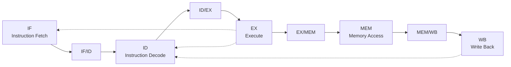

# 5-Stage Pipelined RISC-V Processor using Verilog HDL

## 1. Project Overview

This project implements a 32-bit, 5-stage pipelined RISC-V processor using Verilog HDL.

The processor follows a simplified RISC-V architecture and divides instruction execution into five stages:

1. Instruction Fetch (IF)
2. Instruction Decode (ID)
3. Execute (EX)
4. Memory Access (MEM)
5. Write Back (WB)

The design supports arithmetic, logical, load, store and conditional branch instructions.

It also demonstrates pipeline registers, data forwarding, load-use hazard detection, pipeline stalling and branch flushing.

The design is simulated and verified using ModelSim.

## 2. Objectives

- Understand RISC-V processor architecture.
- Implement a five-stage pipeline.
- Design instruction fetch and decode units.
- Implement an ALU for arithmetic and logical operations.
- Design register file and memory interfaces.
- Implement load and store operations.
- Implement conditional branching.
- Understand data hazards and pipeline forwarding.
- Implement load-use hazard detection and stalling.
- Verify processor operation using a Verilog testbench.

## 3. Processor Architecture

The processor consists of five pipeline stages connected through four pipeline registers.

### Architecture Diagram



### Stage 1: Instruction Fetch (IF)

- Uses the Program Counter (PC).
- Fetches instructions from instruction memory.
- Updates the PC to the next instruction address.
- Passes the instruction and PC to the IF/ID pipeline register.

### Stage 2: Instruction Decode (ID)

- Decodes the instruction opcode.
- Identifies source and destination registers.
- Reads operands from the register file.
- Generates immediate values.
- Generates instruction control signals.
- Performs load-use hazard detection.

### Stage 3: Execute (EX)

- Performs arithmetic and logical operations using the ALU.
- Calculates memory addresses.
- Compares operands for branch instructions.
- Calculates branch target addresses.
- Uses forwarding to obtain the latest operand values.

### Stage 4: Memory Access (MEM)

- Reads data from data memory for LW.
- Writes data into data memory for SW.
- Passes ALU results to the next pipeline stage for other instructions.

### Stage 5: Write Back (WB)

- Selects the ALU result or loaded memory data.
- Writes the result into the destination register.
- Prevents writes to register x0.

## 4. Pipeline Registers

| Pipeline Register | Function |
|---|---|
| IF/ID | Stores fetched instruction and PC |
| ID/EX | Stores operands, immediate, register addresses and control signals |
| EX/MEM | Stores ALU result, store data and control signals |
| MEM/WB | Stores ALU result, memory data and write-back control signals |

## 5. Supported RISC-V Instructions

The processor implements the following instruction subset:

| Instruction | Format | Operation |
|---|---|---|
| ADD | R-type | Addition of two registers |
| SUB | R-type | Subtraction of two registers |
| AND | R-type | Bitwise AND |
| OR | R-type | Bitwise OR |
| ADDI | I-type | Addition with immediate |
| LW | I-type | Load word from memory |
| SW | S-type | Store word into memory |
| BEQ | B-type | Branch if equal |

## 6. Instruction Execution Across Pipeline Stages

All instructions pass through the pipeline stages, but their operations differ.

| Instruction | IF | ID | EX | MEM | WB |
|---|---|---|---|---|---|
| ADD | Fetch | Decode/read | Addition | Pass result | Register write |
| SUB | Fetch | Decode/read | Subtraction | Pass result | Register write |
| AND | Fetch | Decode/read | Bitwise AND | Pass result | Register write |
| OR | Fetch | Decode/read | Bitwise OR | Pass result | Register write |
| ADDI | Fetch | Decode/immediate | Addition | Pass result | Register write |
| LW | Fetch | Decode/read | Address calculation | Memory read | Register write |
| SW | Fetch | Decode/read | Address calculation | Memory write | No write |
| BEQ | Fetch | Decode/read | Compare/branch | No memory access | No write |

## 7. Hazard Handling

### Data Forwarding

Forwarding provides a recently calculated result directly to the ALU without waiting for the register write-back stage.

The design includes:
- EX/MEM forwarding.
- MEM/WB forwarding.
- Forwarding priority for the most recent result.

### Load-Use Hazard Detection

A load-use hazard occurs when an instruction requires data that a previous LW instruction has not yet made available.

The hazard detection unit:
- Detects a dependency between the load destination and the following instruction's source registers.
- Holds the PC and IF/ID pipeline register.
- Inserts a bubble into the ID/EX pipeline register.
- Allows execution to continue after the stall.

### Branch Flushing

When a BEQ instruction is taken:
- The branch target address is selected for the PC.
- Incorrectly fetched instructions are discarded.
- NOP/bubble operations are inserted into the affected pipeline stages.

## 8. Testbench Program

The testbench executes the following instruction sequence:

```asm
ADDI x1, x0, 5
ADDI x2, x0, 7
ADD  x3, x1, x2
SUB  x4, x3, x1
SW   x3, 0(x0)
LW   x5, 0(x0)
ADDI x8, x5, 1
BEQ  x4, x2, +8
ADDI x6, x0, 99
ADDI x7, x0, 11
```

### Expected Execution Results

| Instruction | Expected Result |
|---|---|
| ADDI x1 | x1 = 5 |
| ADDI x2 | x2 = 7 |
| ADD x3 | x3 = 12 |
| SUB x4 | x4 = 7 |
| SW | MEM[0] = 12 |
| LW | x5 = 12 |
| ADDI x8 | x8 = 13 |
| BEQ | Branch taken |
| ADDI x6 | Skipped |
| ADDI x7 | x7 = 11 |

### Expected Final Register Values

| Register | Expected Value |
|---|---:|
| x1 | 5 |
| x2 | 7 |
| x3 | 12 |
| x4 | 7 |
| x5 | 12 |
| x6 | 0 |
| x7 | 11 |
| x8 | 13 |

Data memory:

```text
MEM[0] = 12
```

## 9. Simulation

**Simulation Tool:** ModelSim

### ModelSim Commands

```tcl
vlib work
vlog riscv_5stage.v tb_riscv_5stage.v
vsim work.tb_riscv_5stage
add wave -r /*
run -all
```

### Icarus Verilog Commands

```bash
iverilog -g2012 -o riscv_sim riscv_5stage.v tb_riscv_5stage.v
vvp riscv_sim
```

## 10. Waveform Verification

The ModelSim waveform is used to observe:

- Clock and reset signals.
- Program Counter updates.
- Instruction fetching.
- Pipeline register values.
- Register file updates.
- ALU operations and results.
- Forwarding signals.
- Load-use stall signal.
- Data memory read and write operations.
- Branch decision and flushing.
- Final write-back results.

### Waveform 1 – Pipeline Execution


### Waveform 2 – Hazard Handling


## 11. Design Specifications

| Parameter | Description |
|---|---|
| Architecture | Simplified RISC-V |
| Data width | 32 bits |
| Register count | 32 |
| Register width | 32 bits |
| Pipeline stages | 5 |
| Pipeline registers | 4 |
| Instruction memory | 64 words |
| Data memory | 64 words |
| Instruction formats | R, I, S, B |
| Simulation | ModelSim |

## 12. Design Limitations

- Supports only a subset of RV32I instructions.
- Does not implement all RISC-V instruction formats.
- No multiply or divide instructions.
- No interrupts or exception handling.
- No branch prediction.
- Uses separate instruction and data memories.
- Implements a simplified educational pipeline.

## 13. Technologies Used

- Verilog HDL
- ModelSim
- Icarus Verilog
- RISC-V Instruction Set Architecture
- RTL Design
- Digital Electronics
- Computer Architecture
- Pipeline Design

## 14. Applications

- RISC-V processor design.
- Computer architecture learning.
- RTL design and simulation.
- Digital processor development.
- VLSI design and functional verification practice.

## 15. Future Enhancements

- Support additional RV32I instructions.
- Implement a complete hazard detection unit.
- Improve forwarding and branch handling.
- Add branch prediction.
- Extend the processor with additional pipeline features.
- Develop a SystemVerilog self-checking testbench.
- Implement functional coverage and assertions.
- Develop a UVM-based verification environment.


## References

- RISC-V Unprivileged Architecture Specification
- RISC-V Instruction Set Manual

**Note:** This is an educational five-stage RISC-V subset implementation and is not a complete RV32I-compliant processor.
